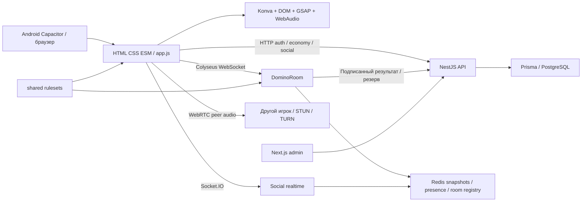

# Архитектура и технический долг

> Аудит 17 октября 2026. Репозиторий `jafarovsamir89/domino2`, ветка `release/play-prep`, коммит `508932ebeb45cde744e3e1dbd92bc5592ca66093`. Проверки только локальные. Игра уже опубликована в Google Play; production и реальные кошельки не изменялись.

## Фактическая схема

Источники истины: онлайн-ходы, руки и очередь — `server/DominoRoom.js`; wallet/ledger/rating — PostgreSQL через API; solo — память клиента; Redis — вторичное восстановление комнаты, не финансовый ledger. Серверный результат имеет HMAC proof, но одной подписи недостаточно для правильной связи результата и резервов. Snapshot не заменяет durable outbox.

## Инвентаризация

671 отслеживаемый файл; карта файлов и размеров — [files.json](evidence/metrics/files.json), карта функций — [function-map.txt](evidence/metrics/function-map.txt), клиентские состояния — [client-state-map.txt](evidence/metrics/client-state-map.txt). Карта получена статическим поиском объявлений; это инвентарь, не доказанный полный граф вызовов.

| Модуль | Размер / назначение | Главная связность |
|---|---|---|
| `js/app.js` | 20 560 строк; игра, social, shop, auth, lifecycle | DOM, API, renderer, timers, localStorage в одном объекте |
| `server/DominoRoom.js` | 4 346; матч, reconnect, ставки, persistence | Schema, Redis, API, таймеры и права пользователя |
| `social.service.ts` | 4 025; друзья, сообщения, invites, gifts | Wallet, presence и realtime events |
| `economy.service.ts` | 3 290; ledger, rewards, shop, settlement | Bootstrap, admin config, player identity |
| `js/renderer.js` / `konvaBoardRenderer.js` | 1 424 / 1 260 | Две системы координат, DOM anchors и canvas |
| `js/network.js` / `account.js` / `voice.js` | 942 / 1 229 / 825 | REST + Colyseus + Socket.IO + WebRTC |
| `js/ai.js` / `board.js` / `model.js` | 168 / 494 / 79 | Дубли server/shared и клиентских правил |
| `packages/db/prisma` | 18 миграций; 39 таблиц после restore | Финансовые операции и social-отношения |

Root workspaces включают `apps/*`, `packages/*`, но `server/` устанавливается отдельно. Зафиксированы Capacitor Android 8.3.1, Better Auth 1.6.9, Next 15.5.16, Prisma 6.19.3, SDK Colyseus 0.17.42 и параллельно `colyseus.js` 0.16.22. Клиент также загружает vendor-копию. Удалять зависимости по имени нельзя: сначала установить реальные consumers и проверить bundle.

## Ветки и артефакты

`main...release/play-prep`: 0 / 65 коммитов на момент получения репозитория. Проверены refs 40 remote branches, включая feature/fix/release; большинство являются предками релизной. В GitHub оставались открытыми #3 online group menu и #4 daily bonus cycle; их старые названия не доказывают отсутствие функциональности в release. Автоматически мержить их нельзя: проверять patch equivalence. Снимок веток: [branches.json](evidence/metrics/branches.json).

Root `js/css/shared` и `www` совпадают в проверяемом checkout. `cap sync android` выполнен; Android assets генерируются, а не хранятся как отдельный проверяемый источник. Установленный Play bundle дополнительно сверен, см. [installed-bundle.json](evidence/metrics/installed-bundle.json). Политика приватности в магазине отличается по формулировкам хранения и ссылкам; это рассинхронизация документа, не иной игровой движок.

README описывает часть старого состояния, в частности GraphQL и прежние параметры. Реальный API — HTTP controllers, Socket.IO social и Colyseus; наличие GraphQL не подтверждено. Нельзя строить план по README без проверки кода. `sync:www` опирается на PowerShell; для переносимого CI нужен Node script с manifest/hash.

## Матрица функциональности

| Возможность | Статус в исследованном коде | Граница доказательства |
|---|---|---|
| Solo Telefon / 101, 2–4 | работает с замечаниями | симуляции + UI + unit; полный UX каждого окончания не пройден |
| Команды 2v2 | реализовано | полные headless матчи выполнены; UI/network soak открыт |
| Открытые / закрытые комнаты | реализовано, опасный restore | живые локальные сокеты |
| Ставки / wallet / ledger | работает с P0 | реальные локальные PG-транзакции |
| Daily / x2 | реализовано, сломана конкурентность | воспроизведение; чистой БД не хватает quest |
| Cosmetics / gifts | реализовано | UI/catalog и source/unit; полный marketplace soak не выполнен |
| Friends / chat / invitations | реализовано частично проверено | API/unit и UI; часть E2E красная |
| Voice | код есть, готовность сетей не доказана | config defect; двух телефонов / TURN теста нет |
| Google / Apple auth | реализовано | настоящий OAuth аккаунт не использован |
| Покупки Google Play | отключены | client flags; запуск реальных покупок не проводился |
| Рекламная монетизация | отключена | наличие reward endpoint не означает SDK/SSV readiness |
| Push | интеграция есть | локально нет google-services.json; доставка не проверена |
| Bot takeover | за feature flag | unit/source; выключен по умолчанию |
| Sentry | инструментирование есть | production DSN, алерты и доставленные события неизвестны |

## Разделение без переписывания поведения

Сначала зафиксировать contract fixtures: команды, полный снимок, delta, score, settlement. Затем выделять из `app.js` модули `GameSession`, `TurnController`, `OnlineSession`, `AccountStore`, `EconomyUI`, `SocialUI` по одному, с сохранением внешнего API. Renderer получает неизменяемую модель представления, не изменяет ход. Правила собираются из одного исходника в ESM/CJS; существующие parity simulations становятся release gate.

Из `DominoRoom` выделить domain reducer, session ownership, persistence adapter и settlement outbox. Обработчик команды проверяет identity + matchId + turnId + commandId, применяет переход один раз, публикует versioned delta. Финансовое событие записывается транзакционно и повторяется worker без зависимости от жизни комнаты. Разделение сервисов на микросервисы сейчас не окупается: границы модулей в текущих процессах дешевле и безопаснее.

## Эксплуатация

Есть nginx-конфигурация `scripts/gcloud/nginx-domino2.conf`, deploy scripts и Docker Compose PostgreSQL. Redis в основном compose не поднимается автоматически. `.github`/CI workflow не найден. Локальный restore выполнен на PostgreSQL 14, тогда как compose предусматривает 17: проверить тот же pipeline на production major. Индексы по рейтингу и social предусмотрены миграциями; EXPLAIN на реальной кардинальности не проводился.

Перед несколькими процессами Colyseus: корректный publicAddress/routing, изоляция process/room registry, sticky WebSocket routing; для Socket.IO — Redis adapter и backpressure. Один локальный burst не определяет production capacity. Логи должны содержать roomId/matchId/commandId/deploySha, но не auth token, private hand и текст личных сообщений по умолчанию.
