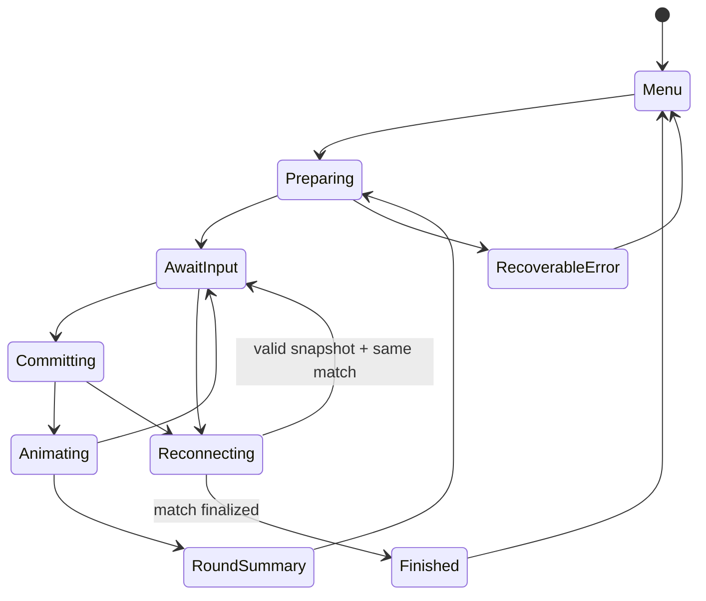

# Зависания и асинхронное состояние

**Дополнение на Android:** force-stop с новым PID и resume offer проверены. Точный core state восстановлен в контролируемом snapshot с остановленным тестом таймером. В обычной новой solo подтверждён **R-40/P1**: меню с Pause не останавливает deadline, через50,321 с у бота уже2 победы в раундах. [Подробности и исключённые попытки](SINGLE_ANDROID_AUDIT.md). Это отдельный дефект от устаревшего async callback R-16.

> Аудит 17 октября 2026. Репозиторий `jafarovsamir89/domino2`, ветка `release/play-prep`, коммит `508932ebeb45cde744e3e1dbd92bc5592ca66093`. Проверки только локальные. Игра уже опубликована в Google Play; production и реальные кошельки не изменялись.

## Подтверждённый stale callback, R-16

`js/app.js:19908` `playTile` запоминает `_turnCycleId`, меняет руку и board, затем ждёт два rAF и `animateTileTravel`. После `await` (`19947`) отсутствует немедленная проверка cycle. Начисление `addScore` происходит в `19980`, а проверка версии защищает лишь часть последующих завершений/advance.

В [client-diagnostics.mjs](evidence/scripts/client-diagnostics.mjs) Promise анимации удержан, turn cycle заменён и scores обнулены, затем Promise завершён. Новый state получил `[10,0]` вместо `[0,0]`. Это **подтверждение дефекта инвалидации контролируемым тестом**, а не доказанная частота зависаний у реальных игроков. Полный пользовательский путь «выход → новая игра» ещё нужно проверить с искусственно затянутой анимацией и реальными нажатиями.

Минимальное исправление: после каждого await проверить sessionId/matchId/turnCycleId и active state до score/settlement/UI mutations. Старый finally не должен снимать блокировку нового хода. Анимация получает cancel/AbortSignal и завершается при hide/dispose. Тест: задержать анимацию, завершить/заменить сессию, отпустить Promise; новая партия не меняется и принимает ход.

## Watchdog не восстанавливает состояние, R-17

`js/app.js:763–768` каждые 2 секунды сбрасывает `turnInProgress`, если прошло 6 секунд от `lastTurnStartTime`. Он не пересоздаёт turnInfo, не сверяет сервер и не отменяет старые callbacks. Подтверждён механизм, но конкретный бесконечный freeze от watchdog не воспроизведён. Риск: повторный ход разблокируется, пока старый async ещё жив.

Безопасная замена — диагностировать зависший phase, отменить animation token, восстановить authoritative snapshot для online либо завершить deterministic local transition. Таймаут не должен сам дописывать очки. Записывать phase, turnId, длительность, visibility и причину recovery.

## Модель состояний

У каждого перехода один владелец, входные guards и выходной cleanup. `turnInProgress`, `postMoveWindowActive`, `roundOver`, `matchOver`, `networkActionBlockedForReconnect`, `pendingOnlineAction` сейчас допускают множество комбинаций. Не заменять все boolean за один PR: сначала журнал переходов и инварианты, затем выделение TurnController.

## Матрица сценариев

| Сценарий | Проверено / результат | Остаток |
|---|---|---|
| Solo background 5/15/30/60/120 с | реальный телефон, 28 костяшек, меню отвечает | не телефонный звонок и не убийство процесса ОС |
| Разрыв WebSocket и reconnect | реальные локальные комнаты | см. сетевую матрицу; no-input влияет на timeout |
| Stale анимация после invalidation | score переносится в новый state | пользовательский E2E + cancel test |
| Двойной tap | guard есть, часть E2E | стресс по hand/arrow/bazaar на реальном телефоне не завершён |
| Ошибка Promise travel | catch разблокирует boolean | проверить, что рука/board/score согласованы |
| Offline outbox chat | есть обработчик online | порядок, удаление аккаунта и multi-device не нагрузочно проверены |
| Поворот / resize | есть ResizeObserver и layout retry | физический landscape + split-screen не выполнены |
| Последняя костяшка | reveal delay и unit tests | один excluded source-test красный, визуально повторить |
| API outage во время результата | in-memory retry 5 с | durable result не должен исчезать с room/process |

Невозможно доказать обнаружение «абсолютно всех» зависаний конечным набором тестов. Следующий диагностический этап: запись state version, event sequence, timers count и recovery latency в dev builds; кольцевой буфер последних 100 переходов без личных данных. Пользователь видит объяснимое восстановление и кнопку выхода, а не вечный spinner.
