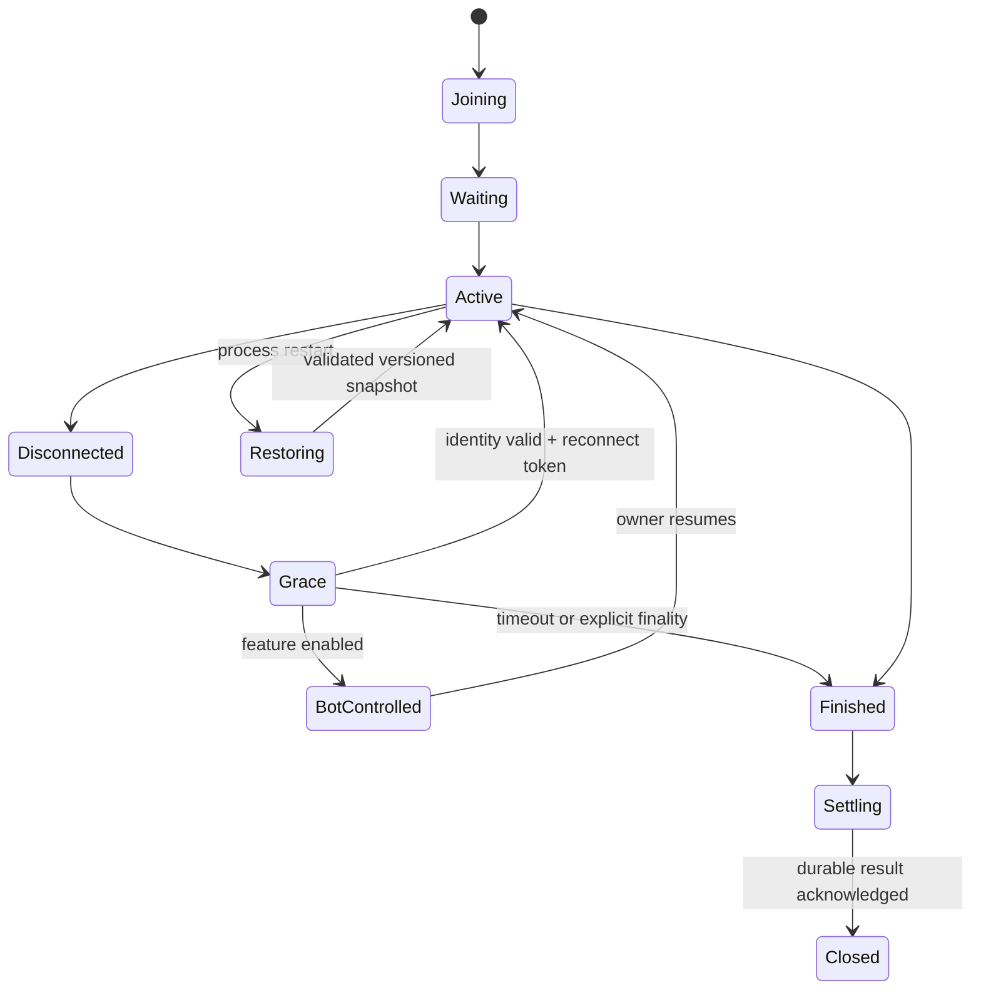

# Сеть, восстановление и серверная ёмкость

**Дополнение:** реальные поиск/дружба/приглашение на Android и API peer прошли; Telefon-партия343 команды/34 совпавших state checks завершилась.100 SDK-клиентов с API/PG отработали30 мин и drain; БД подтверждает453 расчётных матча,100 сверенных кошельков, reserved0. Cleanup harness пришлось завершить отдельно; число команд≥123075. [Полный протокол и пределы](SINGLE_ANDROID_AUDIT.md). Это не fault drill commit/ACK и не проверка предельного CCU.

> Аудит 17 октября 2026. Репозиторий `jafarovsamir89/domino2`, ветка `release/play-prep`, коммит `508932ebeb45cde744e3e1dbd92bc5592ca66093`. Проверки только локальные. Игра уже опубликована в Google Play; production и реальные кошельки не изменялись.

## Локальная проверка

Действительные Colyseus clients подключались к локальному серверу, Redis 8.10.2 core и локальному API. Профили синтетические, ставки free; реальные аккаунты не использовались. Для независимых прогонов выделены разные Redis DB. Во время подготовки обнаружена контаминация registry при двух серверах с общей БД и разными портами; эти промежуточные результаты исключены, финальные метрики получены с изоляцией.

## R-04 — штатный restart теряет снимок, P0

[network-faults.json](evidence/metrics/network-faults.json): активная партия `gameActive=true`, snapshot exists=1. После SIGTERM локального процесса snapshot exists=0. Новое создание с restore получило `restore_snapshot_not_found`. Проверка выполнена также для ожидающей комнаты.

Причина по коду: `DominoRoom.js:4337–4340` сохраняет custom state перед `disconnect`, а `onDispose:1434–1440` удаляет те же keys. Сохранение перед shutdown не даёт durability, если обычный dispose его отменяет.

Минимум: различать terminal match disposal и process shutdown; сохранять snapshot с generation/version, не удалять его при рестарте, восстанавливать только после проверки владельца и финальности матча. Старые snapshots истекают по TTL или удаляются отдельной terminal operation. Тест: 4 участника, ход/score/reserve, SIGTERM и новый процесс; те же руки/очередь/таймеры/matchId и ровно один settlement. Дополнительно SIGKILL и потеря Redis требуют отдельного прогона; вывод этого теста ограничен graceful restart.

## Reconnect без пользовательских ходов

| Разрыв | Результат локального опыта | Интерпретация |
|---|---|---|
| 5 с | тот же sessionId и hand, active=true | базовый reconnect прошёл |
| 15 с | то же, active=true | прошёл |
| 30 с | session/hand сохранены, active=false, matchOver=false | промежуточное состояние timeout; визуальное продолжение отдельно не проверено |
| 60 с | room disposed | в этой партии другие участники тоже не ходили; нельзя изолировать причину как сбой grace |
| 120 с | session/hand сохранены, active=true | один удачный случай, не гарантия всех партий |

Партии создавались параллельно с разными случайными начальными очередями. Поэтому нелинейность 60/120 с не означает, что 120 безопаснее 60. Требуется детерминированный replay с активными остальными игроками и отдельной фиксацией timeout/forfeit events.

Реальное solo на телефоне при HOME/return 5/15/30/60/120 с сохранило 28 костяшек и доступность меню. Это отдельный результат, не доказательство online hand recovery через мобильную сеть.

## Session state

Готовность места, connection, controller и match status — разные вещи. `isConnected=false` не означает, что место свободно. Explicit leave должен отличаться от transport loss. Room lock и отсутствие client должны сохранять корректный outcome, включая 2v2.

## Burst ёмкость

| Клиенты | sync p50, мс | p95 | p99 | RSS сервера, MiB | Ошибки burst |
|---:|---:|---:|---:|---:|---:|
| 10 | 2.6 | 2.9 | 2.9 | 123.4 | 0 |
| 50 | 2.1 | 4.0 | 4.1 | 137.3 | 0 |
| 100 | 3.8 | 6.8 | 7.0 | 145.3 | 0 |
| 200 | 6.7 | 12.7 | 13.2 | 152.1 | 0 |
| 500 | 18.0 | 31.1 | 32.4 | 222.0 | 0 |
| 1000 | 28.0 | 54.3 | 56.3 | 273.8 | 0 |

[network-load.json](evidence/metrics/network-load.json), [скрипт](evidence/scripts/network-load.mjs). 10/50 включают неполные последние комнаты; `activeResponses` отдельно записан в JSON. Каждая ступень — подключение и один конкурентный sync burst, весь прогон короткий. Это **не проверка 1 000 постоянно играющих людей**, не p95 хода через интернет и не production SLA. CPU в `ps` — короткая process average, не точный профиль загрузки. API/wallet, DB contention, voice и social в burst не нагружались.

Нельзя перевести 1 000 сокетов напрямую в 100 000 DAU. Модель: average CCU=DAU×sessions/day×minutes/session/1440, peak условно ×3; реальные пики зависят от географии, событий и длины матча. Тестировать сначала точный action workload и запас до SLO, затем прогнозировать DAU.

## Матрица отказов и остаток

| Отказ / сценарий | Статус | Точная следующая проверка |
|---|---|---|
| Create/join 2–4, seat/full state | локально выполнено, нагрузка до 1000 connections | 30 минут command workload, action p99 |
| Авторизованный чужой restore | дефект ownership подтверждён | negative regression после исправления |
| Grace 5–120 | mixed, см. выше | seeded turn и активные другие участники |
| Graceful server restart | потеря snapshot подтверждена | сравнение state до/после patch |
| API restart/outage | code retry найден, fault drill не выполнен | прервать после commit и до ACK, проверить ledger |
| Redis временно недоступен | локальный SIGSTOP10 с: команды работают, HTTP health timeout R-39 | data loss/failover/new join и платные расчёты;30 с outage |
| Wi-Fi→LTE / packet loss / jitter | локальный stream jitter/bandwidth выполнен; реальные сети/loss нет | два реальных устройства + управляемая сеть; RTT 50/150/400 мс, jitter ±50, loss 1/3/10% |
| Повтор invite / одинаковый recipient | unit/source частично | concurrent accept 20×, одна reservation/room |
| Duplicate/out-of-order actions | guards/unit частично | commandId и stale turnId, одинаковые hashes после sync |
| WebRTC через разные NAT | не выполнено | Wi-Fi/LTE, relay-only TURN и отказ credentials |

В `server/index.js:63–95` default STUN задан строкой, но dedup принимает только массив: default `/api/voice/config` возвращает пустой iceServers. Клиент имеет собственный STUN fallback, поэтому утверждать «voice всегда не работает» нельзя. Исправить контракт urls и добавить config test. Для реальных операторских NAT нужен проверенный TURN с временными credentials, egress budget и наблюдаемым ICE outcome.

## Сервисная эксплуатация

До масштабирования: health/readiness, event-loop lag p95/p99, active rooms/clients, socket send-buffer, Redis latency, Prisma pool wait и locks, settlement retry age, reserved-money age, completed/abandoned matches. Для restart — drain новых join, durable snapshots/outbox, завершение или миграция активных комнат, deploySha и rollback manifest. Постоянная очередь результатов важнее добавления ещё одного replica.

## Дополнение: команды, задержки и Redis

В [продолжении анализа](CONTINUATION_ANALYSIS.md) приведены финальные данные четырёх условий TCP stream delay/jitter/bandwidth:48/48 команд приняты, состояние четырёх клиентов согласовано. p95 ответа при 200±50 мс в каждую сторону —470,5 мс. Это не потеря IP-пакетов и не реальная смена мобильной сети.

Реальная command-нагрузка на 20/100/200 соединений по 45 с дала 624/3132/6069 принятых действий, p95 ответа 3,71/3,77/4,11 мс, ноль отклонений/таймаутов и 80/80 согласованных checkpoints. Наблюдаемый максимальный RSS среди 5-секундных выборок:161,7/218,8/246,6MiB; это не доказательство отсутствия утечки. Паузы между раздачами входят во время, перед действием harness делает sync. Эти данные не закрывают длительный soak, capacity ceiling, API/wallet/DB contention или hosting SLA.

При SIGSTOP выделенного тестового Redis на 10,15 с существующая бесплатная комната приняла 32 команды; после SIGCONT следующая команда принята,28 костяшек и публичное состояние согласованы. Это сохранение работающего процесса при зависании Redis; Redis restart/data loss/new-room availability в момент отказа отдельно не проверены. [Основной результат](evidence/metrics/active-network-check.json).

### R-39 P1: HTTP liveness зависает вместе с Redis

Отдельный повтор короткого fault drill подтвердил: до отказа `/health` и `/health/ready` отвечают 200; во время pause оба не отвечают в пределах клиентского deadline1500 мс; после возобновления снова 200 примерно за 2 мс. Игровые WebSocket-команды существующей комнаты при этом выполняются. [HTTP probe](evidence/metrics/redis-readiness-check.json), [повтор только Redis](evidence/metrics/active-network-check-redis-only.json).

Причина по коду: `server/index.js:197` ставит Redis rate limiter перед всеми маршрутами, включая health:233/237. Он ожидает `INCR` без конечного command deadline для живого, но не отвечающего соединения. Сам `health.js` смотрит status клиента вместо ограниченного по времени PING. Зависший health может приводить к лишним перезапускам, если такую проверку использует оркестратор; фактическая production health policy неизвестна.

Минимальное исправление: независимый liveness без Redis/БД/общего limiter; readiness с bounded проверкой необходимых зависимостей и 503 при timeout, без бесконечного ожидания. Приёмка: SIGSTOP и отдельный connection-refused Redis, liveness<500 мс, readiness503<1000 мс, recovery200; сохранение комнаты и отсутствие лишних settlement. R-39 не исправлялся в рамках аудита.

Старые строки матрицы выше означают состояние первого прохода. Локальные stream jitter/throttling, короткий command load и Redis pause теперь выполнены в указанном объёме. Реальный loss/Wi-Fi→LTE/NAT, API commit/ACK fault, Redis data loss и долговременная нагрузка остаются открытыми.
