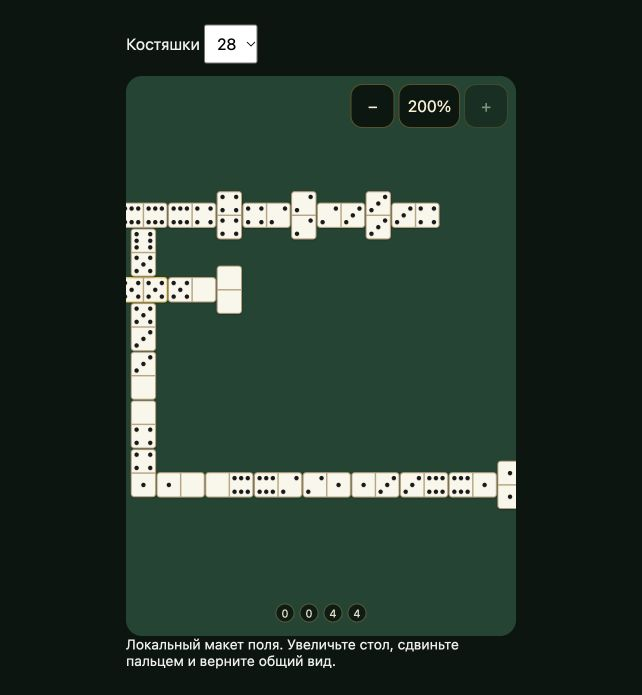

# R-24 — локальная проверка масштаба стола

Текущий код поля, synthetic20/28tiles из существующего board-quality fixture; никакой активной онлайн-комнаты. Capture: Codex in-app browser, локальный `board-review.html`, поле390×560 внутри viewport. Skill Product Design Audit. Это проверка механики и читаемости конкретного макета; не тест с реальными игроками и не весь игровой экран с руками/аватарами.

1. **Исходный вид, проблема читаемости:**28tiles помещаются, но короткая сторона костяшки визуально мала; управления масштабом нет. [Снимок01](01-board-before.png).
2. **Общий вид с управлением, работает:**добавлены три кнопки44px, подписанные AZ/RU/EN. Поле остаётся центрированным. [Снимок02](02-board-fit.png).
3. **Увеличение, работает:**200%делает значения заметно крупнее; за границами видна только часть цепочки, что ожидаемо при приближении. [Снимок03](03-board-zoom.png).
4. **Сдвиг, работает:**drag показывает правый конец; границы сдвига не позволяют потерять всё поле. Arrow keys доступны при фокусе региона. [Снимок04](04-board-pan.png).
5. **Общий вид, работает:**кнопка/Escape возвращает100%и нулевой сдвиг. E2E отдельно подтверждает сброс после очистки того же объекта Board и после resize. [Снимок05](05-board-reset.png).

Четыре browser cases root/www ×20/28tiles проверяют увеличение/пределы, реальный drag, равенство reported и actual canvas coordinates, inverse travel coordinates, неизменность состояния партии, reset/Escape, playable end choice, resize и сброс после очистки. Восемь существующих проверок реального canvas/DPR тоже проходят. Качество буфера mobile≤1.25/desktop≤2, hit1 сохранено; увеличение не увеличивает DPR/backing-store cap.

Оставшиеся UX/доступность риски: реальный пользователь должен понимать, что увеличенное поле можно сдвинуть; нужно проверить удобство на телефоне в полной партии. Снимки не доказывают TalkBack/полную accessibility compliance, FPS или качество всех table skins. Базовый фон продукта этим прототипом не заменён. Полная R-24 требует игры с людьми, поэтому остаётся частичной.
